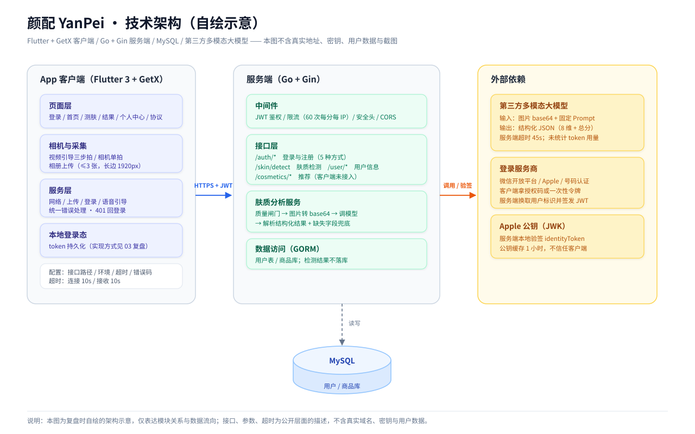
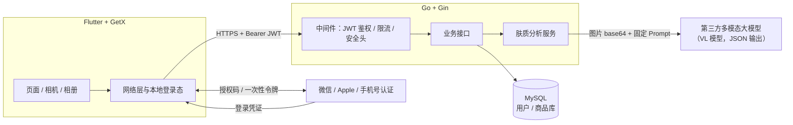
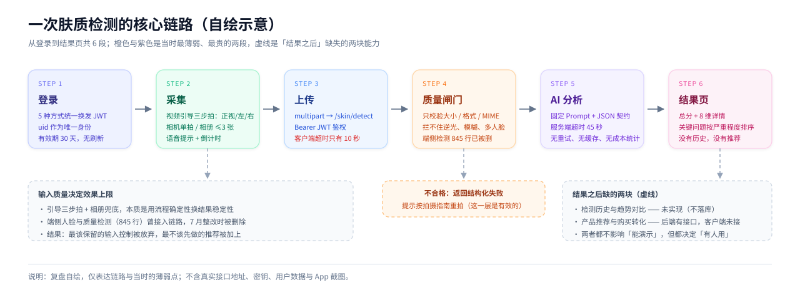

# 颜配 YanPei · AI 肤质检测与美妆推荐 App（工程复盘）

**一句话**：颜配是一个「拍照 → AI 肤质分析 → 个性化护肤建议（原计划延伸到产品推荐与购买转化）」的移动端 AI 产品。我用 Flutter 写 App、用 Go 写服务端，独立把主链路做完了；**MVP 完成、走过一轮 App Store 审核整改，但没有正式上线，也没有营收**。

> 本仓库是对该项目的产品与工程复盘，**不包含**原项目源码、配置、截图、密钥或任何用户数据。所有架构图与流程图均为自绘 / Mermaid 示意图。
> 结论先行：这个项目工程完成度不低、产品验证度很低。仓库的价值在于「差一点就能上线」的地方到底差在哪。

---

## 30 秒版本

- **做了什么**：Flutter（GetX）+ Go（Gin）+ MySQL + JWT 的完整 App；5 种登录方式、3 种拍照入口、多模态大模型肤质分析、8 维结果页、语音引导拍摄。
- **做成什么程度**：前后端主链路可跑通、服务端可部署（Docker + Nginx + HTTPS）、有 CI 与测试、隐私协议齐全、完成过 App Store 审核整改。
- **结果**：没有正式上架，没有用户规模与营收数据，检测效果也没有做过量化评测——这三点是复盘里最需要诚实说明的。
- **最能说明问题的一件事**：商品库与推荐引擎（7 张表、约 700 行推荐逻辑、电商联盟接口桩）是在上架整改当天补的，而客户端从头到尾没有调用过一次；真正影响效果的端侧质量检测，反而在整改里被当成「无用代码」删掉了。

---

## 1. 项目定位

| 项 | 内容 |
|---|---|
| 产品形态 | iOS / Android App（Flutter）＋ Go 服务端 |
| 技术栈 | Flutter 3 + GetX + camera/image_picker；Go + Gin + GORM/MySQL + JWT；第三方多模态大模型（百度千帆）；微信 / Apple / 手机号一键登录 |
| 我的角色 | 独立完成：产品定义 + 客户端 + 服务端 + 联调 + 上架材料与审核整改 |
| 时间 | 2025-05 ～ 2025-08 主建设期（约 3 个月，前后端各约 26 / 30 次提交）；之后停更 |
| 代码规模 | 后端 Go 93 个文件约 1.8 万行（含测试 0.67 万行）；App Dart 63 个文件约 2.0 万行（含测试 0.14 万行） |
| 当前状态 | **已完成 MVP，未正式上线；项目已停止推进** |
| 商业结果 | **无营收、无公开用户数据**；产品处于「可演示、未验证」阶段 |

- **目标用户**：20–35 岁、有基础护肤意识但不会看成分、也说不清自己「现在到底什么问题」的城市女性。
- **非目标**：不做皮肤科诊断、不做处方建议、不做医美导流——这三条既是能力边界也是合规边界，当时写进了产品设想，但落地时并没有真正守住（见 [docs/01-product.md](docs/01-product.md)）。

---

## 2. 我的角色与边界

一个人做完一个移动 App 的产品 + 前后端，需要说清楚哪些是我的判断、哪些是现实约束下的将就：

- **产品**：场景与用户假设、核心链路、功能范围与取舍、Prompt 设计与输出契约、结果页信息结构、审核与隐私材料。
- **客户端**：页面与路由、相机与相册采集、视频引导三步拍（TTS 语音提示）、上传与错误处理、结果页与本地登录态。
- **服务端**：Gin 路由与中间件、JWT 鉴权、5 种登录的服务端校验、大模型调用与结果解析、错误码体系、配置与部署。
- **不是我的**：没有设计师（UI 是我按 Material 风格自绘）、没有测试同学（测试是我自己写的）、没有运营与投放。

---

## 3. 技术架构

- **为什么是 Flutter + GetX**：一个人要同时交付 iOS/Android，Flutter 是当时最省人力的选择；GetX 负责路由、状态与依赖注入，学习成本低、样板代码少。
- **为什么服务端是 Go + Gin**：接口数量不多、并发要求不高，Go 的部署简单（单二进制）和类型安全对我更重要。
- **为什么用第三方多模态模型**：见下一节决策 1。

完整的调用时序、鉴权细节、AI 调用的失败路径与成本问题在 [docs/02-architecture.md](docs/02-architecture.md)。

---

## 4. 核心链路（一次肤质检测）

1. **登录**：邮箱 / 手机验证码 / 手机号一键登录 / 微信 / Apple，服务端统一换发 JWT。
2. **采集**：三种入口——视频引导三步拍（正视、左转、右转，TTS 语音提示 + 倒计时）、相机单拍、相册上传（最多 3 张，长边压到 1920px）。
3. **上传**：multipart 上传到 `/skin/detect`，JWT 鉴权。
4. **服务端质量闸门**：只校验文件大小 100KB–10MB、扩展名、MIME；不过关直接返回结构化失败信息。
5. **AI 分析**：图片转 base64，连同固定 Prompt 发给多模态大模型；要求输出固定 JSON（肤质类型、8 个维度、问题维度集合、总分公式、25 字总体评价）。
6. **解析与兜底**：服务端剥离 Markdown 代码块、字段映射、缺字段给兜底文案（这一步做得不干净，见 02）。
7. **结果页**：总分 + 关键问题 + 8 维详情；**没有**检测历史、**没有**产品推荐（后端有接口，客户端没接）。

链路里最贵的一段是第 5 步（每次检测要处理 3 张图 + 一段长 Prompt），最弱的一段是第 4 步（质量闸门形同虚设）。这个组合决定了产品「能做出来、但做不准」。

---

## 5. 关键决策（背景 → 取舍 → 结论 → 代价）

### 决策 1：肤质分析用第三方多模态 API，不自研模型

- **背景**：2025 年中，视觉多模态模型已经「能用」；我只有一个人、没有皮肤图像数据集、也没有标注和评测条件。
- **取舍**：自研/端侧模型（可控、边际成本低，但要有数据、训练和评测）vs 第三方 API（一周能接完，但输出不稳定、按量计费、数据要出端）。
- **结论**：接百度千帆的 VL 模型，把「输出稳定」当成工程问题解决：Prompt 固定 JSON 结构 + 服务端字段映射 + 缺失字段兜底。
- **代价**：结果一致性差且无法度量；成本随图片张数/尺寸线性涨，没有做任何成本监控；医疗/护肤类结论有合规风险，只能靠文案免责。

### 决策 2：采集做成「引导式三步拍」，不追求智能抓拍

- **背景**：这类产品的效果上限由输入决定（光线、角度、距离、是否单人脸），而普通用户不会拍标准照。
- **取舍**：端侧人脸检测 + 质量评分做自动抓拍（已写过 845 行 ML Kit 实现）vs 固定流程 + 语音引导 + 服务端校验。
- **结论**：改成「视频引导三步拍（正视 / 左转 / 右转各一张）+ 相册兜底」，用流程确定性换取实现成本与稳定性。
- **代价**：拍摄环节变重、耗时；端侧质量检测在 7 月上架整改时被当作「无用代码」删除，质量闸门退化成「文件大小 + 格式」——本末倒置。

### 决策 3：登录方式一次做全（5 种）

- **背景**：C 端拉新依赖手机号/微信；iOS 上架要求「若提供第三方登录，必须同时提供 Apple 登录」。
- **取舍**：只做邮箱/手机号（快，但不符合审核与真实获客）vs 全做（覆盖全、审核稳，但工作量大）。
- **结论**：5 种全做；手机号一键登录先后试了三家 SDK，中间有返工。
- **代价**：登录与鉴权吃掉大量时间，却没有任何产品差异化；JWT 30 天有效但**没有刷新机制**，过期只能重新登录；**没有账号注销**（这是上架合规缺口，见 03）。

### 决策 4：检测结果只回传、不落库

- **背景**：照片和肤质属于敏感信息，MVP 阶段优先降低隐私与存储成本。
- **取舍**：落库做检测历史/趋势（留存钩子、可做效果对比）vs 不落库（隐私面小、实现快）。
- **结论**：不落库；照片写服务端临时目录、调用完即删。
- **代价**：产品没有「回访理由」——用户测完就走，无法做前后对比，也无法沉淀效果数据用于迭代。

### 决策 5：推荐系统的顺序做反了（先做后端引擎，后做前端闭环）

- **背景**：商业闭环设想是「检测 → 推荐 → 购买 → 联盟佣金」。
- **取舍**：先人工维护 30 个 SKU 的规则映射跑通点击转化 vs 先建完整商品库与推荐引擎。
- **结论**：选了后者——7 张表、品牌/分类/成分/产品/购买链接、4 种推荐策略、电商联盟接口桩。
- **代价**：客户端从未调用这些接口，商品图片还是占位地址；**这条最贵的链路没有经历一次真实点击**。这是我在这个项目里最大的范围判断失误。

---

## 6. 结果与边界（不粉饰）

**做完了**：主链路可跑通；5 种登录 + 3 种采集 + 结果页可用；服务端可部署（容器化 + Nginx + HTTPS + 生产配置清单）；有 CI 与测试（后端 27 个测试文件，CI 带 MySQL/Redis 服务）；隐私政策、用户协议、未成年人保护规则齐全；完成过一轮 App Store 审核整改。

**没做到**：

- **没有正式上线**。MVP 之后项目停止推进，没有走完完整的提审与上架流程，也没有公开可下载版本。
- **没有用户规模、留存、转化数据**；没有营收（产品从未收费）。
- **没有效果评测**：皮肤类型与 8 维结论的准确率、同一用户重复检测的一致性，仓库里找不到任何量化记录。所以本仓库**不做任何效果承诺，也不建议把它的结论用于护肤决策**。
- **推荐闭环未成立**：商品库是占位数据，联盟接口未接真实密钥，客户端未接入。
- **合规缺口**：没有账号注销入口；照片虽不落库，但第三方模型调用的数据流向没有做用户侧说明。

**公开这个项目的原因**：它是我第一个「从产品定义一路做到上架门口」的完整项目，它的失败点（验证缺失、范围失控、AI 输出不可控）比成功点更有参考价值。所以它只作为**工程复盘**公开，不作为「AI 产品成果」展示。

---

## 7. 阅读顺序

| 顺序 | 文件 | 看什么 |
|---|---|---|
| 1 | [docs/01-product.md](docs/01-product.md) | 问题与场景、核心链路、功能取舍，以及「为什么没上线」的完整复盘 |
| 2 | [docs/02-architecture.md](docs/02-architecture.md) | 前后端架构与数据流、登录鉴权、AI 调用的失败路径与降本空间 |
| 3 | [docs/03-lessons.md](docs/03-lessons.md) | 做对了什么、哪些是过度设计、如果重来怎么收敛、对 AI 应用产品经理的启示 |

如果只有 5 分钟：看 01 的「为什么没上线」和 03 的「过度设计清单」——这两节是这个项目最真实的部分。

---

## 8. 仓库说明

- 本仓库**不含**原项目任何源码、配置、环境变量、证书、抓包、构建产物或 App 截图；不引用任何生产地址、密钥与个人信息。
- 原文事实来自 2025-05 ～ 2025-08 的私有仓库提交记录与工程文档；图与文档为本次复盘重新撰写。
- 基于自绘图的说明见 [assets/README.md](assets/README.md)。
- 原项目采用木兰宽松许可证 v2（Mulan PSL v2）；本仓库未搬运其代码，文档与自绘图为本仓库原创，转载/引用请注明出处。

---

## 相关仓库与链接

- [geo-showcase](https://github.com/zhaolijian/geo-showcase)：源引 GEO：诊断模型、内容 Agent 与评测边界
- [chinese-rose-showcase](https://github.com/zhaolijian/chinese-rose-showcase)：阅记：纸质书笔记助手的产品、架构与止损复盘
- [ai-lab](https://github.com/zhaolijian/ai-lab)：AI 应用方法论集（含个人 AI 协作工作流）
- [ProductThinking](https://github.com/zhaolijian/ProductThinking)：产品思考文章与读书笔记
- 作品集站点：<https://zhaolijian.github.io>
- GitHub 主页：<https://github.com/zhaolijian>
