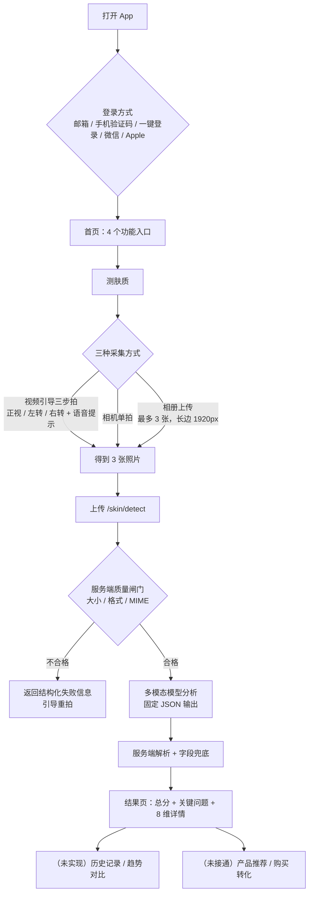

# 01 · 产品：一个「拍照测肤」到底解决了谁的问题

> 这一篇回答三个问题：我当初认为它解决什么问题、实际做成了什么、以及为什么最后没有上线。
> 全部是第一人称复盘。**「事实」和「我现在的判断」会分开写**——这个项目最缺的就是把这两者分开。

---

## 1. 问题与用户场景

### 1.1 我当时的判断

护肤消费的决策链条是：**判断自己现在的皮肤状态 → 找到对应的成分/品类 → 在货架或电商页里选一支 → 买**。普通用户卡在前两步：说不清自己属于什么肤质、也看不懂成分表，于是依赖柜姐、博主、或「感觉」。

我当时的假设链是这样的：

1. 手机拍照已经足够方便，**用一张照片换一个「够用」的肤质读数**，成本远低于去线下做皮肤检测；
2. 用户拿到「你现在的主要问题是屏障受损 + 缺水」这类结论后，**愿意接受对应的产品建议**；
3. 如果建议能直接导向购买链接，**就能从电商联盟拿到佣金**，形成商业闭环。

**事实是：这三条假设在项目周期内没有留下任何被验证的证据。** 没有用户访谈、没有问卷、没有可用性测试，也没有任何检测结果的对照实验——仓库里连一份用户研究记录都没有。这是这个项目最根本的问题，后面所有「为什么没上线」都从这里长出来。

### 1.2 三个具体场景（我做功能时脑子里的画面）

| 场景 | 用户当下在做什么 | 用户真正想要的 | 产品当时给的 |
|---|---|---|---|
| A. 换季烂脸 | 爆痘、泛红、脱皮，不知道该补水还是控油 | 一个「现在该做什么、不该做什么」的明确结论 | 8 个维度的现状 + 建议，但**没有严重程度分级和优先级外的行动清单** |
| B. 想买一套护肤品 | 在电商页面/货架前，被成分和营销话术淹没 | 「我这个情况，买哪几支」 | 检测结果页；**没有推荐**（推荐在后端，没接到客户端） |
| C. 想知道护肤有没有效 | 用了一个月产品，想对比前后 | 可对比的历史记录与趋势 | **没有历史**（检测结果不落库） |

场景 A 是产品真正能闭环的切口；场景 B 才是能赚钱的切口；场景 C 是能带来留存的切口。**我三个都想要，结果 B 和 C 都没做完整**（详见第 3 节）。

### 1.3 目标与非目标

- **目标用户**：20–35 岁、有基础护肤意识但不会看成分、也说不清自己皮肤状态的城市人群。
- **非目标（当时写下的边界）**：不做皮肤科诊断、不做处方/用药建议、不做医美导流。
- **回看这条边界的执行情况**：文案上写了免责，但产品形态（「总分 + 8 维结论 + 改善建议」）在体感上已经很接近「诊断」。**边界写进了设想，没有落进交互和文案的分寸里**——这是后来让我不敢上线的原因之一。

---

## 2. 核心链路与信息结构

### 2.1 链路

### 2.2 为什么要「引导三步拍」而不是让用户自由上传

- **背景**：这类 AI 功能的上限由输入决定——光线、距离、角度、是否单人脸，任何一项不达标，模型输出的可信度都会崩。
- **取舍**：智能抓拍（端侧人脸检测，只在检测到合格人脸时自动按下快门）vs 固定流程 + 语音引导（正视、左转、右转各一张）。
- **结论**：先做智能抓拍（真的写了 845 行端侧人脸检测与质量评分），后来为了稳定性和交付，收敛成「流程确定性优先」的引导三步拍，相册上传做兜底。
- **代价**：拍摄环节变长、变重；但更重要的是——**7 月上架整改时，那条端侧质量检测链路被当作「无用代码」删掉了**，服务端只剩文件大小/格式校验。输入质量控制从「有」变成「没有」，这是本末倒置（见 [03-lessons](03-lessons.md)）。

### 2.3 结果页：为什么是「总分 + 8 维 + 问题排序」

产品上必须给用户一个可回答的结论，而不是一堆模型生成的形容词。所以我把输出结构定死：

- **一个总分**（0–100）：让用户有「可对比」的锚点，也方便结果页做视觉重心；
- **皮肤类型 + 8 个状态维度**：皮肤类型单独给结论；纹理、水油平衡、毛孔、屏障、肤色&色素、敏感、老化、痤疮 8 项各自给「现状｜建议」；
- **问题维度集合（按严重程度排序）**：让用户先看最该解决的几个问题，而不是平均用力；
- **25 字以内总体评价**：作为一句话结论。

Prompt 里甚至把总分公式写死成 `76 + 良好维度数 × 3 − 问题维度数 × 3`，并要求模型输出前自检——目的是让结果可渲染、可比较、可解释。这个「把 AI 输出变成契约」的思路我自己认为是这个项目里少数做对的地方（详见 [02-architecture](02-architecture.md)）。

**但结果页也有硬伤**：没有「这次和上次比怎么样」，没有「按这个建议做多久能看到变化」，没有「什么情况下应该去看医生」。这三句话缺一句，用户都很难把它当成一个持续使用的工具。

---

## 3. 功能范围与取舍

| 类别 | 内容 | 当时的理由 | 事后看 |
|---|---|---|---|
| **做完并可用** | 5 种登录、3 种采集、AI 检测、结果页、协议/隐私页、语音引导拍摄 | 覆盖真实用户入口与上架合规 | 登录过度投入，采集与结果页是对的 |
| **做完但没接** | 商品库 + 推荐引擎 + 电商联盟接口（后端 7 张表、约 700 行逻辑） | 想尽快验证商业闭环 | **最大的错**：客户端从未调用，商品图还是占位地址，零真实点击 |
| **做完又删** | 端侧人脸检测 + 质量评估（845 行，ML Kit） | 想用质量闸门提高结果稳定性 | **删错了**：删掉了最该保留的东西 |
| **只留入口** | 首页「测穿搭 / 测发型 / 测妆容」3 张卡片 | 想表达产品想象力 | 对外观感与交付不符，全部点击只弹「即将上线」 |
| **没做** | 检测历史/趋势、账号注销、分享、埋点与指标、效果评测 | 时间与优先级 | 每一个都直接削弱留存/合规/迭代能力 |
| **做偏了** | 本地 token 自研加密、设备指纹、穿搭 3D 模型页 | 想显得「企业级」 | 典型的 AI 辅助开发导致的过度设计（见 03） |

两个范围判断值得单独说：

**决策 A：首页放 4 个功能卡，只做了 1 个。**
- 背景：想做一个「AI 美妆工具箱」，不止测肤。
- 取舍：只放已实现功能（诚实、单薄）vs 放完整愿景（有想象力、有落差）。
- 结论：放了 4 个，3 个挂了「即将上线」。
- 代价：任何真实用户第一次点就会遇到落差；对面试官也一样，这比只做一个入口更减分。

**决策 B：检测结果不落库。**
- 背景：照片与肤质是敏感数据，落库意味着存储、加密、删除、合规说明的完整义务。
- 取舍：不落库（隐私成本最低、实现最快）vs 落库（能做历史对比与留存，但要承担数据责任）。
- 结论：不落库，只做即时展示；照片在服务端临时目录处理完即删。
- 代价：产品没有留存钩子，也永远无法用真实数据做效果迭代——**把「合规省事」变成了「产品失能」**。

---

## 4. 为什么没上线（最需要诚实的一节）

### 4.1 能确认的事实（时间线）

| 时间 | 发生了什么 |
|---|---|
| 2025-05-15 | 前后端仓库同一天初始化，MVP 开始 |
| 2025-05 ～ 06 | 手机号一键登录反复换 SDK；微信登录联调；登录体系成型 |
| 2025-06-30 | 视频检测 / 拍照检测 / 相册上传三条链路开发测试完成 |
| 2025-07-04 ～ 07-05 | Prompt 输出结构调整为「问题维度集合」；前后端统一使用 uid |
| 2025-07-14 | 补齐错误码与统一响应格式 |
| 2025-07-30 | App Store 审核整改（微信未安装时隐藏入口、去掉 WebView 强制下载、配置改为环境变量注入）＋同一天加入商品库/推荐引擎/测试框架 |
| 2025-08-11 ～ 08-19 | Docker/部署脚本、iOS 部署自动化等收尾优化 |
| 2025-08-19 之后 | 没有实质性产品提交；项目停止推进，**未正式上线** |

### 4.2 我现在的归因（判断，不是当时的正式结论）

项目周期内没有留下正式的复盘文档，下面是回看时的归因，按我认为的权重排序：

1. **效果不可验证，所以不敢对外承诺。**
   同一张脸不同光线、不同距离，模型给的结论可能差一档；而我既没有评测集，也没有一致性指标。一个「说你屏障受损」的产品，如果结论不稳定，就不是体验问题，是责任问题。

2. **商业闭环从头就没有真的设计过。**
   推荐引擎做完了却没接前端；商品数据是占位；联盟接口没有真实密钥；也没有任何购买路径的埋点。等于花了最贵的时间，买了一台从来没有插电的机器。

3. **合规与审核成本被低估。**
   护肤结论涉及功效宣称边界、照片与生物特征数据的处理说明、账号注销等硬要求。我做到了「有隐私协议」，没做到「能过审的产品形态与数据生命周期」——账号注销至今没有。

4. **范围失控导致资源全部花在「让产品看起来完整」上，而不是「让假设被验证」。**
   5 种登录、4 个入口、7 张商品表、3 套手机号登录 SDK、端侧人脸检测、自研本地加密、3D 穿搭页……这些都很「完整」，但没有一件在回答「用户到底需不需要它、它测得准不准」。

### 4.3 止损的判断

停下来的决策依据（回看时我认可的判断）：**在「效果无法度量」的前提下继续投入，只会把不确定性越堆越大。** 一个连自己输出是否可信都说不清的 AI 功能，先做增长或先做商业化都是在放大风险。

**代价**：约 3 个月的个人时间、云资源与域名投入，以及一个本可以更早拿到结论的机会。**收益**：完整的移动端 0→1 经验、AI 输出工程化的方法、一次真实的「范围失控」教训——这三样在后续项目里都用上了。

---

## 5. 如果重来：把「能演示」换成「能验证」

如果只允许我用 6 周重做这个项目，我会这样收敛：

| 周 | 做什么 | 产出与判定 |
|---|---|---|
| W1 | 砍到单一场景（换季问题肌）、单一采集方式（相册上传 3 张）、单一登录（邮箱，不做一键登录/微信/Apple） | 一条能跑通的窄链路 |
| W2 | 补质量闸门：服务端做图片解码校验 + 端侧做轻量亮度/人脸存在性检查；定义「不合格输入」的提示文案 | 无效请求能被拦在模型调用之前 |
| W3 | 10 人小样本一致性测试：同一人固定光线拍 3 次，比较皮肤类型与 Top3 问题是否稳定 | **一致性 ≥ 70% 才继续** |
| W4 | 推荐 v0：人工维护 30 个 SKU 的「问题 → 品类/成分」规则映射，结果页展示并记录点击 | 有人真的点了才叫闭环 |
| W5 | 稳定性：超时对齐、失败重试上限、结果缓存、每日限次、成本统计（每次检测的图片数/耗时/估算费用） | 能算清单次成本 |
| W6 | 合规收口：账号注销、数据说明、审核材料；灰度给 20 人 | 能回答「用户会不会再测第二次」 |

**指标先行**（当时的我一条都没定义，这是最大的产品失职）：

- **结果一致性**：同一人同场景 3 次检测，皮肤类型一致率、Top3 问题重合率；
- **链路质量**：检测成功率、P50/P95 耗时、失败原因分布；
- **用户价值**：7 天内是否按建议采取行动（自报）、次周是否复测、是否愿意推荐给朋友；
- **成本**：单次检测的模型调用成本、无效请求占比。

---

## 6. 面试官可能会追问

**Q：你说这是 AI 产品，那 AI 在里面创造了什么价值？**
A：它把「用户说不清的皮肤状态」变成一份结构化读数（8 维 + 问题排序）。价值是否成立，取决于两点：读数准不准、用户是否据此行动。第一点我没测，第二点我没做入口——所以现在只能把它定义成「已验证链路、未验证价值」的原型。

**Q：为什么不用更小的模型 / 端侧模型降低成本？**
A：当时没有评测集，换模型无法判断好坏；端侧模型还叠加了包体、机型覆盖和迭代成本。我选了「先跑通再优化」，但正确顺序应该是先建立最小评测集，再谈模型选型——这是顺序错了，不是选项错了。

**Q：为什么推荐系统做完了却没上线？**
A：因为它在客户端没有入口。这是范围管理失误：我把「后端能力完整」误当成「产品能力完整」。

**Q：这个项目你最大的收获是什么？**
A：不是 Flutter 或 Go，而是「先定义可接受的 AI 输出，再写第一行代码」。后来我做 GEO 产品时，第一件事就是定义评测口径和人工抽检机制——那是这个项目教的。

---

## 7. 边界声明

- 本项目**未正式上线**，没有公开可下载版本、没有用户规模与营收数据。
- 本仓库**不做任何效果承诺**：既没有准确率数据，也不建议任何人把它当年的检测结论用于护肤决策。
- 文中「为什么没上线」的归因是我的事后判断，不是当时的正式复盘结论；时间线以提交记录为准。
