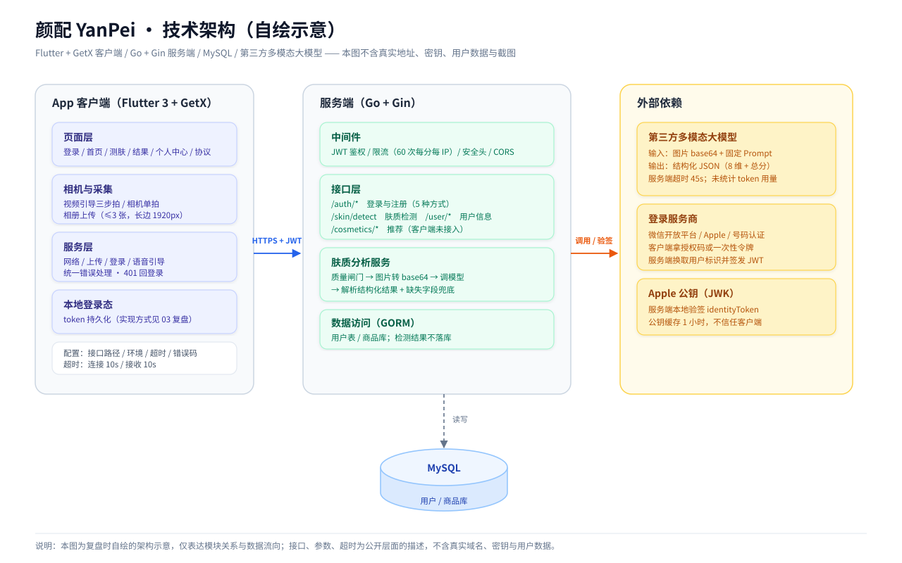
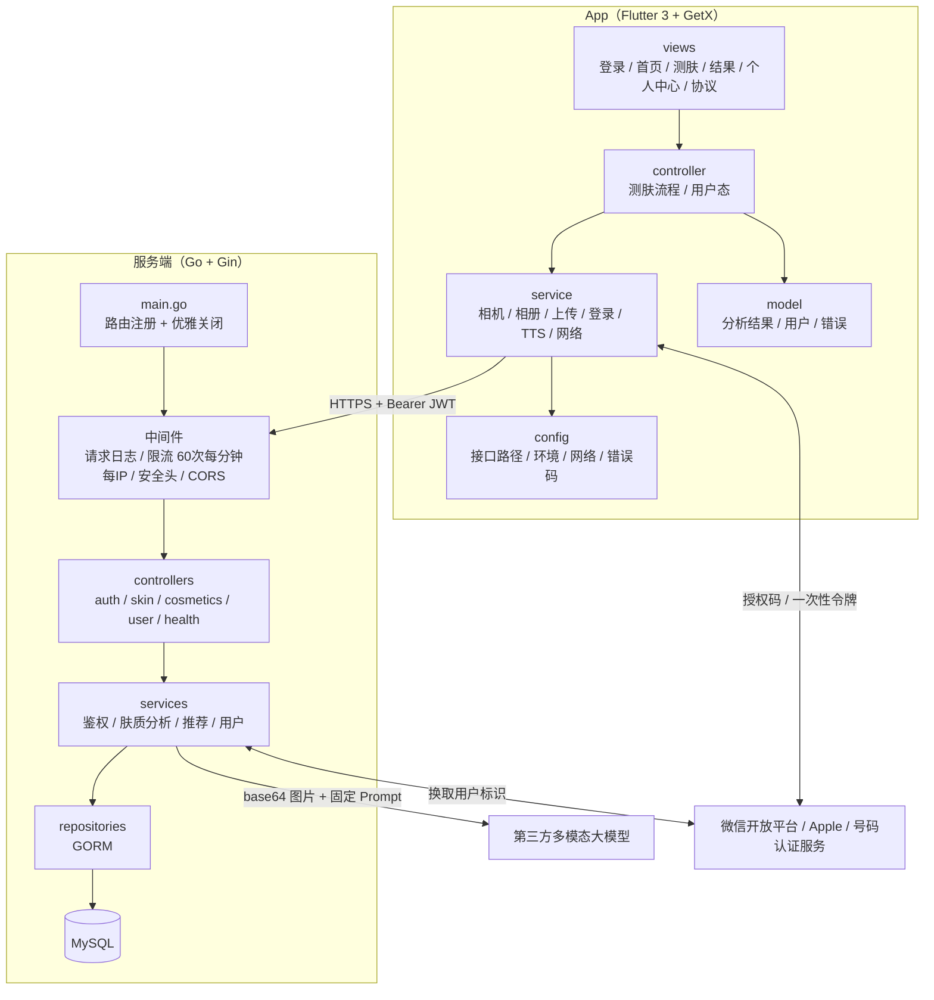
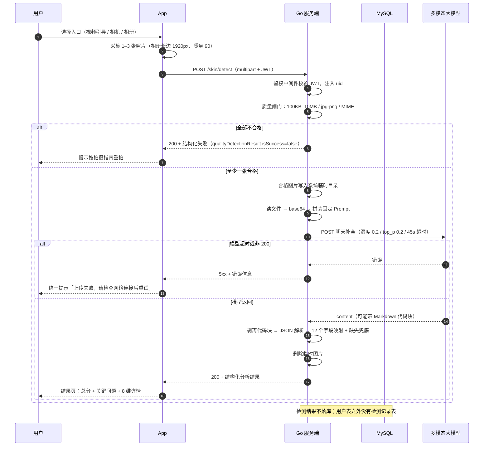
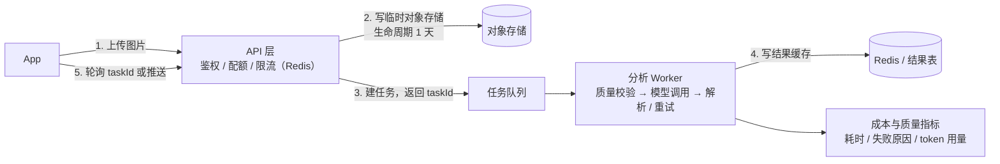

# 02 · 架构：一条检测请求的完整旅程

> 这一篇讲工程：前后端怎么分工、一次检测请求经过了什么、登录鉴权怎么做的、AI 调用在哪里会坏、以及当时完全没有做的成本意识。
> 所有实现细节来自原私有仓库，本仓库**不搬运源码与配置**；文中接口与参数为示意性描述，不含任何密钥、地址与个人信息。

---

## 1. 总览





**分层原则**：客户端按 `view → controller → service → config/model` 单向依赖；服务端 `main → middleware → controller → service → repository`，外部依赖（数据库、模型、登录服务商）只在 service/repository 层出现。

**当时的技术选型理由**：

- **Flutter + GetX**：一人同时交付 iOS/Android；GetX 一站式解决路由、状态、依赖注入，样板代码少。代价是没有强约束，代码组织靠自律——这也是后来测肤流程的 controller 与 service 都到了 700–850 行的原因。
- **Go + Gin + GORM**：接口少、并发要求不高，看重单二进制部署与类型安全。
- **Viper 多环境配置**：开发 / 生产两套配置 + 环境变量覆盖，JWT 密钥与第三方密钥全部走环境变量注入（生产环境还会校验密钥长度并拒绝默认值启动）。
- **Redis**：配置文件里接入了 Redis 客户端，但**业务代码从未真正使用**——只在启动/关闭时初始化。这是典型的「架构看起来完整、实际没用上」。

---

## 2. 一次检测的端到端时序



**时间预算**：视频引导拍摄本身约 10–15 秒（3 秒倒计时 + 三个阶段各含等待与语音提示）；模型调用设计超时 45 秒；而**客户端连接超时与接收超时各只有 10 秒**。这三个数字放在一起就是一个真实的 bug，见第 4 节。

---

## 3. 登录与鉴权

### 3.1 五种登录方式

| 方式 | 客户端拿到什么 | 服务端如何校验 | 产物 |
|---|---|---|---|
| 邮箱 + 密码 | 邮箱、密码 | bcrypt 校验密码强度与哈希 | JWT |
| 手机验证码 | 手机号 + 验证码（验证码由手机号 SDK 侧处理） | 服务端没有独立的短信校验接口，只通过 `/auth/phone-register` 查/建用户 | JWT |
| 手机号一键登录 | 运营商侧一次性令牌 | 服务端用令牌向号码认证服务换取手机号并校验 | JWT |
| 微信 | 微信授权 code | 服务端用 code 换 access_token → 取 unionid/openid | JWT |
| Apple | identityToken（JWT） | **服务端本地验签**：拉取 Apple 公钥（JWK，缓存 1 小时），校验签名与签发方，读 sub/email/是否私密中继邮箱 | JWT |

两点做得比较扎实，也值得被同类项目复用：

1. **Apple 登录不是「信客户端」**：服务端拉 Apple JWK 缓存并本地验签，而不是把 identityToken 当成可信输入；同时处理了「隐藏我的邮箱」返回的私密中继地址（单独字段 + 唯一索引 + 登录类型标记）。
2. **统一 uid**：所有登录方式最终都映射到同一个内部用户 uid，JWT 里也以 uid 为准，避免多登录方式下的用户分裂（这一项 7 月初专门重构过一次）。

两点是不该有的：

1. **服务端注册了完整的登录路由，但客户端配置里还留着一条服务端从未注册的短信登录路径**——「配置先行、实现没跟上」的遗留，属于死配置。
2. **手机号一键登录先后试过三家 SDK，中间整段重写、删旧接新**，是登录链路上最贵的一段返工。

### 3.2 JWT 与本地登录态

- **算法**：HS256；claims 含 `id`、`uid`、`exp`、`iat`，可选带手机号/邮箱/微信 unionid；有效期 **30 天**。
- **服务端校验**：中间件强制校验签名算法必须是 HMAC（防算法混淆），校验通过后把 uid 注入上下文，业务层只认 uid。
- **客户端**：统一在请求头注入 `Authorization: Bearer <token>`；遇到 401 清空登录态、延迟 1.5 秒跳登录页。
- **缺口**：
  - **没有刷新机制**。客户端配置里有一个 `/token/refresh` 地址，服务端并没有这条路由，refresh 回调也从未实现——30 天到期后用户只能重新登录。
  - **没有吊销机制**。改密码、退出登录、设备丢失都无法让已签发的 token 失效。
  - **本地 token 存储用了自研加密**（AES 之名、多轮 XOR 之实），这是过度设计里最该批评的一项，详见 [03-lessons](03-lessons.md)。

---

## 4. AI 检测调用与降级（这一节是全文重点）

### 4.1 输出契约：把「模型说什么」变成「产品要什么」

产品需要的结果是固定结构，不是一段散文。所以 Prompt 把输出约束成一份 JSON 契约：

- **皮肤类型 + 8 个状态维度**：皮肤类型单独给单选结论；纹理、水油平衡、毛孔、屏障、肤色&色素、敏感状态、老化迹象、痤疮状况 8 项各自输出；
- **每个维度固定格式**：「现状描述｜建议方案」，各 10–15 字；
- **问题维度集合**：从 8 维里筛出有问题的，按严重程度排序，数组返回；
- **总分公式写死**：`76 + 良好维度数 × 3 − 问题维度数 × 3`，要求模型输出前自检；
- **总体评价**：从问题维度里挑 3 个最严重的给建议，25 字以内。

再配上服务端解析：剥离 Markdown 代码块 → JSON 反序列化 → 12 个字段逐个映射 → 缺字段给兜底。

**为什么这是对的**：模型输出不可控，但产品界面是可预期的。把「可渲染、可比较、可解释」的要求前移到 Prompt 和解析层，是 AI 应用最基础的工程动作。

**为什么做得还不够**：契约只约束了「格式」，没有约束「质量」——格式对了但内容是幻觉，服务端完全识别不出来（没有任何一致性校验或置信度字段）。

### 4.2 调用参数

| 项 | 当时的值 | 说明 |
|---|---|---|
| 模型 | 第三方 VL（视觉）模型 | 图片走 base64 data URL 内联 |
| 输入 | 1–3 张图片 + 约 1.5k 字 Prompt | 视频模式固定 3 张 |
| 温度 / top_p | 0.2 / 0.2 | 追求稳定输出，方向正确 |
| 流式 | 关闭 | 一次性返回，同步等待 |
| 超时 | 服务端 45 秒 | 客户端只有 10 秒（见 4.4） |
| 结果统计 | **无** | 没有解析 token 用量，没有记录成本 |

### 4.3 质量闸门：名义上有，实际上没有

一次检测的成本主要由模型调用决定，所以「不合格的图片不要送进模型」是这类产品最划算的工程动作。当时的实际状况：

| 层级 | 做了什么 | 效果 |
|---|---|---|
| 客户端 | 校验文件存在、大小非 0、扩展名是 jpg/png（**仅此而已**） | 拦不住逆光、模糊、多人脸、非人脸 |
| 服务端 | 100KB–10MB、扩展名、MIME（MIME 不匹配只告警不拒绝） | 只能拦住「明显不是图片」的文件 |
| Prompt | 写了一句「非人脸图片和多人脸照片自动跳过」 | 这是**给模型的提示**，不是产品能力：它既不能事先拦截，也不能降低成本 |

**最讽刺的一点**：项目里真的写过一个 845 行的端侧人脸检测 + 质量评估服务（单人脸校验、亮度/清晰度/对比度评分、智能增强重试），并且接进了上传链路（在 Isolate 里跑）。但在 7 月底的上架整改里，它被当成「无用代码」连同 ML Kit 依赖一起删除了。于是质量闸门从「有一层重的」退化成「只有文件大小校验」——**把最该保留的能力删了，把最不该现在做的推荐引擎加了**。

### 4.4 失败路径与降级（逐条诚实评估）

| 失败场景 | 当时的实际行为 | 问题 | 应该怎么做 |
|---|---|---|---|
| 所有图片质量不合格 | 返回 200 + 结构化失败，客户端提示重拍 | 可接受 | 保持 |
| **模型耗时长于客户端超时** | 服务端还在算，客户端 10 秒已断开并提示「网络错误」 | **真实 bug**：用户重试 → 重复计费；错误语义也错了 | 客户端超时 ≥ 服务端超时 + 余量；长任务改异步 + 轮询/推送 |
| 模型超时（45s） | 返回 5xx，客户端统一提示「上传失败，请检查网络连接后重试」 | 错误语义错配（模型超时 ≠ 用户网络问题） | 区分错误码：超时/服务异常/图片问题/额度问题 |
| 模型返回非 JSON | 解析失败 → 5xx | 没有重试，一次格式抖动就整次失败 | 低温度重发一次；或要求 JSON mode / function calling |
| JSON 缺字段 | 给兜底文本；**总分缺失时默认 60 分** | **最差的设计**：给用户一个凭空的分数 | 缺关键字段就明确「本次结果不完整」，不给假数据 |
| 模型调用失败 | 没有重试、没有缓存、没有规则兜底 | 单点依赖，失败即 100% 不可用 | 失败重试（有限次）+ 结果缓存 + 降级为「确定性规则建议」 |
| 同一用户重复检测 | 每次都重新调用模型 | 无缓存、无限次，成本随刷随涨 | 图片指纹/结果缓存 + 每日限次 |

**一句话总结降级现状**：只做了「失败时别崩」，没做「失败时还能给价值」。对一个 AI 功能来说，后者才是产品能力。

### 4.5 如果重做这一块

1. **三层闸门**：端侧轻量预检（亮度采样 + 人脸存在性 + 模糊检测，不引重依赖）→ 服务端解码校验（能否解码、分辨率、人脸数）→ 模型侧结构化质检（可让同一模型先只回答「这张图能不能分析」）。
2. **超时对齐**：客户端超时必须大于服务端；服务端把「模型调用」从同步请求里拆出来，改成任务 + 轮询。
3. **契约升级**：输出增加「置信度 / 无法判断」字段，让产品能区分「测出来没问题」和「测不出来」——这两件事对用户的意义完全不同，当时的实现把它们混成同一个分数。
4. **失败可解释**：把失败原因透传给前端，而不是一律「网络错误」。

---

## 5. 成本意识（诚实说：当时几乎没有）

### 5.1 单次检测的成本构成

- **图片输入**：每次 1–3 张、长边最高 1920px，多模态模型按图片折算 token，图片越大、张数越多越贵；
- **Prompt 输入**：固定 Prompt 约 1500 字（含维度标准、分数公式、自检要求），每次调用都重复计费；
- **输出**：要求返回 12 个字段的结构化 JSON，约几百 token；
- **无效请求**：质量闸门形同虚设，不合格图片照样产生模型调用费用；
- **重复请求**：客户端超时早于服务端（10s vs 45s）导致用户重试，同一次检测可能被计费两三次。

### 5.2 当时做了什么、没做什么

| 做了 | 没做 |
|---|---|
| 服务端按 IP 限流 60 次/分钟（内存版） | 没有按用户限次、没有配额、没有防刷 |
| 模型温度调低以稳定输出 | 没有解析 token 用量、没有成本统计、没有成本告警 |
| 相册入口限制长边 1920px | 没有进一步压缩（对模型来说 720–1024 往往够用） |
| 服务端 45 秒超时兜底 | 没有结果缓存、没有降级，失败即全额浪费 |

**结论：这个功能当时的单次成本，我自己算不出来。** 算不出成本，就不能定价、不能设计免费额度、不能判断「要不要换更便宜的模型」——而这恰恰是 AI 产品经理最该在 PRD 里写清楚的一行。这是这个项目里我认为最典型、也最可迁移的教训。

### 5.3 降本优先级（如果重来）

1. 端侧压缩到长边 720–1024、质量 80：几乎不改体验，显著降输入 token；
2. 质量闸门前置：把无效请求拦在模型调用之前；
3. 同一用户/同一图片的短期结果缓存；
4. 每日免费次数 + 超限提示（既是成本控制也是产品节奏）；
5. Prompt 精简：8 个维度不必每次都要全部长文本，可只让模型输出问题维度；
6. 模型分级：先用便宜模型判断「图片是否可分析」，再用 VL 模型做正式分析。

---

## 6. 数据与隐私边界

**做到了的**：

- 服务端不持久化检测图片：写系统临时目录，调用模型后删除；
- 检测结果不落库：用户表之外没有检测记录表，产品层也没有历史记录；
- 隐私合规三件套存在（用户协议、隐私政策、未成年人保护规则）；
- Apple 私密中继邮箱单独字段处理。

**没做到、也不该被忽略的**：

- **图片会离开自己的系统**：base64 上传到第三方模型服务，但用户协议里没有针对「照片与肤质数据会传给第三方 AI 服务」的专门说明；
- **没有账号注销**：账号体系完整，却没有删除账号与数据的入口（上架合规硬要求）；
- **没有数据生命周期设计**：不落库并不等于合规，用户无法查看/删除自己的历史，因为「没有历史」这件事对用户来说不可感知。

---

## 7. 工程与部署

**做得比较规矩的部分**：

- Viper 多环境配置 + 环境变量覆盖；生产环境启动时校验 JWT 密钥长度、拒绝默认密钥启动；
- 开发自签证书 → 生产证书的 HTTPS 双环境方案，HTTP 自动重定向 HTTPS；
- 优雅关闭（30 秒超时，停服务 → 关数据库/Redis 连接）；
- 安全头、Content-Type 校验、CORS 白名单、统一错误码与响应格式；
- 容器化部署（Dockerfile + docker-compose + Nginx 配置 + 生产检查清单）；
- CI：后端测试跑在带 MySQL/Redis 服务的流水线上；客户端也有 Flutter CI；后端 27 个测试文件覆盖 unit/integration/e2e。

**明显的规模局限**：

- 单机同步架构：一次检测占用一个 HTTP 连接最多 45 秒，没有队列、没有 worker，并发一高就排队；
- 限流是**进程内内存 Map**，重启即清零、多实例不共享；
- 没有对象存储（图片不落盘持久化）、没有监控/告警/链路追踪，排障靠日志；
- 模型调用没有幂等设计，客户端重试会重复计费。

### 7.1 如果重新设计



变化点：**同步请求改异步任务**（解决超时错配）、**限流与缓存上 Redis**（解决单机局限）、**图片走临时对象存储**（解决大文件内存与生命周期）、**成本与质量指标进观测**（解决「算不清」）。这套东西在 2025 年我做不出来也不该做——正确做法是先把手里的同步链路做对，而不是先搭一套「标准架构」。

---

## 8. 附：分析结果契约（示意，非原始代码）

```json
{
  "score": 82,
  "skinType": "混合性",
  "problemDimensions": ["屏障功能", "水油平衡"],
  "skinBarrier": "角质层偏薄｜建议舒缓修护",
  "overallEvaluation": "重点修护屏障，减少清洁频率",
  "qualityDetectionResult": { "isSuccess": true, "imageResults": [] }
}
```

这份契约是这个项目里少数我认为最值得复用的资产：**任何要展示 AI 结论的产品，都得先有一份这样的结构，再谈模型选型。**
