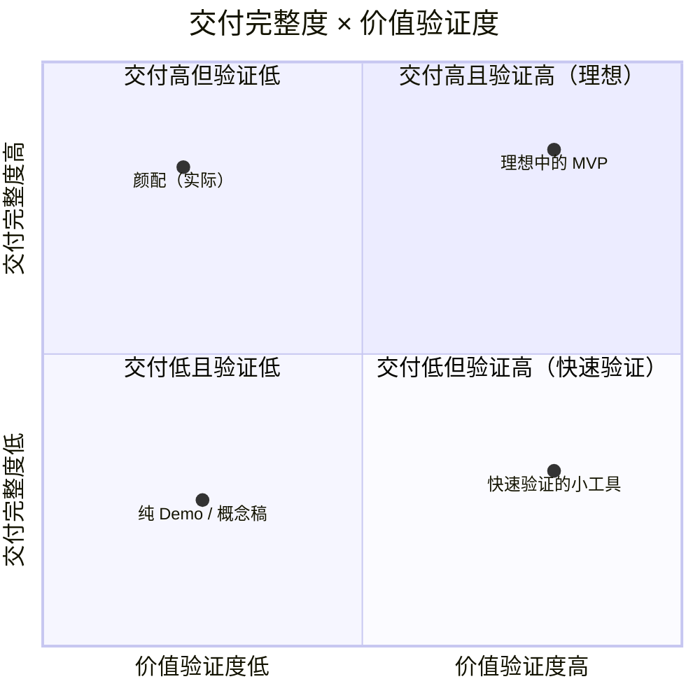

# 03 · 复盘：做对了什么、什么算过度设计、如果重来怎么收敛

> 这一篇是产品与工程的双重复盘，写给两类人：一类是看我这个项目到底怎么「失败」的面试官；另一类是我自己——避免下次再用「交付完整度」替代「价值验证」。
> 评价标准只有两条：**它有没有帮产品更值得被使用**、**它有没有帮团队更快拿到结论**。单人项目没有「团队」，但判断标准一样。

---

## 0. 先立一个标尺

一个人三个月写出约 3.8 万行代码（后端 Go 1.8 万行、App Dart 2.0 万行）、42 个 Markdown 文件，听起来很多。但如果把项目放在「**交付完整度 × 价值验证度**」两个轴上：

颜配的问题不是「做得少」，而是**做得太多、验证得太少**。所以下面「做对了什么」的评价标准不是「代码写得对不对」，而是「它是否朝价值验证前进了一步」。

---

## 1. 做对了什么

### 1.1 把 AI 输出做成了契约，而不是一段话

- **做了什么**：Prompt 固定 JSON 结构（8 维 + 问题维度集合 + 总分公式 + 25 字总体评价），服务端做字段映射与缺失兜底，前端按固定字段渲染。
- **为什么对**：AI 输出不可控，但产品界面必须可控。把「可渲染、可比较、可解释」的要求前移到 Prompt 和解析层，是 AI 应用最基础、最高性价比的工程动作。
- **证据**：结果页的 8 个维度、总分、问题排序全部来自结构化字段，前端不需要理解自然语言。
- **局限**：只约束了「格式」，没约束「质量」——没有置信度、没有一致性校验，格式对但内容是幻觉时系统识别不出来。

### 1.2 先跑通端到端主链路，再补细节

- **做了什么**：3 个月内完成「5 种登录 → 3 种采集 → 上传 → AI 分析 → 结果页」的完整闭环。
- **为什么对**：对单人项目，最难的不是写好一个模块，而是让所有模块串起来能演示。主链路跑通之后，每一个优化都有地方可以落。
- **代价**：主链路上的每一段都停在「能用」——拍摄引导能跑、结果页能看、推荐没接。这也是后面范围失控的起点：链路跑通之后，我选择了「加模块」而不是「加验证」。

### 1.3 隐私最小化（方向对，执行不完整）

- **做了什么**：检测图片只在服务端临时目录处理、调用后删除；检测结果不落库；协议、隐私政策、未成年人保护规则齐全。
- **为什么对**：照片与肤质属于高敏感数据，「不存」是成本最低、风险最小的合规策略。
- **局限**：不落库同时砍掉了产品价值（没有历史对比）；图片仍会传给第三方模型，但没有向用户专门说明；账号注销缺失。**「省事」和「负责」不是一回事。**

### 1.4 上架合规前置

- **做了什么**：Apple 登录（提供第三方登录时的 App Store 审核要求）、Apple 私密中继邮箱处理、微信未安装时隐藏登录入口、去掉 WebView 强制下载逻辑、协议页与权限说明。
- **为什么对**：这些不是「上线前再补」的东西——它们会直接决定能不能上架，以及用户第一次打开时的信任感。
- **证据**：2025-07-30 完成一轮针对审核要求的整改，客户端与服务端同步修改。
- **局限**：整改只覆盖了「入口与配置」，没有覆盖「账号注销」「第三方 AI 数据流向说明」这两项更根本的合规义务。

### 1.5 工程基线做得比产品成熟

- **做了什么**：环境变量注入密钥（生产拒绝默认密钥启动）、JWT 鉴权中间件、统一错误码与响应格式、HTTPS 双环境、优雅关闭、安全头、日志、CI（后端测试跑 MySQL/Redis 服务）、容器化部署配置。
- **为什么对**：这些是「上线型项目」的必要条件，也让我第一次完整体会了「生产可用」的门槛。
- **反面**：**工程基线的完成度远超产品验证度**。27 个后端测试文件、CI、覆盖率产物、每日报告都齐了，但产品连「同一张脸测三次结果是否一致」都没有留下任何记录。工程严谨性被用在了错误的地方。

---

## 2. 哪些是过度设计

> 判断标准：**它服务的是一个已被验证的需求，还是一个想象中的需求？** 下面每一条，我当时的理由都听起来很专业，事后看都站不住。

### 2.1 推荐引擎先于推荐入口（最大的失误）

- **做了什么**：7 张商品库表（品牌/分类/成分/产品/成分关联/购买链接/推荐日志）、约 700 行推荐服务、4 种推荐策略（品牌档位 / 销量 / 成分 / 智能）、电商联盟 API 接入桩、228 行种子数据。
- **当时的想法**：「检测 → 推荐 → 购买转化」是商业闭环，先把后端能力建好。
- **为什么是过度**：客户端**从未调用过任何一个推荐接口**（我把接口写在服务端，却没有在 App 里接入口）；商品图片是占位地址、联盟 API 没有真实密钥、也没有任何点击埋点。**这条链路一次都没有被真实用户走过。**
- **更刺眼的细节**：这套东西是在 7 月 30 日「上架整改」那天一次性加进去的——本该是收敛的一天，我选择了扩张。
- **正确做法**：人工维护 30 个 SKU 的「问题 → 品类/成分」映射，放进结果页，先看有没有人点。有 5% 点击率再谈商品库。

### 2.2 自研「企业级加密」

- **做了什么**：为本地保存 token 写了一套加密方案：设备指纹派生密钥、PBKDF2 一万次迭代、HMAC-SHA256 完整性校验、「防重放」「时序攻击防护」，文档标题写着「AES-256 加密」。
- **实际实现**：核心是**三轮 XOR**——不是 AES。也就是说，文档里写的安全属性，代码并没有提供。
- **为什么是过度**：MVP 阶段本地 token 防护的性价比极低——正确的做法是 HTTPS + 短期 token + 平台安全存储（Keychain / Keystore），一行依赖能解决的事不该自研。
- **真正的教训**：**AI 辅助开发最容易生成「看起来专业的安全方案」**。我当时的审查只看了文档和函数名，没有读加密实现——这类错误对 AI 产品经理同样致命：你不懂实现细节，就无法判断 AI 给的方案是不是在糊弄你。

### 2.3 端侧人脸检测：方向对，做法重，最后被删

- **做了什么**：845 行端侧人脸检测与质量评估（单人脸校验、亮度/清晰度/对比度评分、智能增强重试、Isolate 异步执行），接入上传链路。
- **当时想法**：质量闸门是提高结果准确率最划算的手段——这个判断本身是对的。
- **为什么失败**：实现引了重依赖（ML Kit），链路又长；在 7 月 30 日上架整改时被作为「无用代码」删除。**方向正确的能力，因为实现太重而被整体放弃**，最终质量闸门只剩「文件大小 + 格式」。
- **正确做法**：轻量预检（采样亮度 + 人脸存在性 + 模糊度，不引重依赖）→ 服务端解码校验 → 不合格就明确提示重拍。拦在模型调用之前，既提质量又降成本。

### 2.4 五种登录方式 + 三套号码认证 SDK

- **做了什么**：邮箱、手机验证码、手机号一键登录、微信、Apple 全做；手机号一键登录先后尝试三家 SDK，中间有代码删除与重建。
- **为什么是过度**：登录是「零差异化」功能。对验证「AI 测肤有没有价值」这件事，一种登录就够。真实用户不会因为我支持微信登录而多测一次。
- **代价**：大量时间消耗在 SDK 集成、权限、审核要求上；同时留下了 30 天无刷新、无吊销、无注销的技术债。

### 2.5 用「即将上线」撑起的产品想象力

- **做了什么**：首页 4 个功能入口（测肤质、测穿搭、测发型、测妆容），只有第一个能用；另外做了带 3D 模型的穿搭推荐页面。
- **为什么是过度**：入口是承诺，不是装饰。第一次点击就遇到「即将上线」的用户，不会觉得产品有想象力，只会觉得它不诚实。
- **代价**：直接损害了「完成度」的观感——而这恰恰是我最想展示的东西。

### 2.6 交付物通胀：文档、报告、测试的数量代替了质量

- **做了什么**：后端 29 个 Markdown、App 13 个 Markdown（含各种「商业化级」「企业级」方案文档）、每日自动报告、覆盖率报告与测试产物入库；App 的 README 还是 Flutter 默认模板；有两个文档只有标题（文件 1 字节）；TFLite 依赖在 pubspec 里挂了两个多月，代码里从未 import。
- **为什么是过度**：这些「产出」让仓库看起来很专业，但**没有一个在回答「产品值不值得做」**。每日报告里质量检查、测试结果全是「暂无记录」——自动化生成了一份内容为空的仪式感。
- **数量**：三个月的代码与文档产出，远超「验证一个假设」所需的量。**AI 把执行力放大了 3 倍，也把「用产出掩盖方向缺失」放大了 3 倍。**

---

## 3. 如果重来：怎么收敛

### 3.1 一条原则

**每个工作日结束前回答一个问题：今天我让哪一个假设离被证实/证伪更近了一步？** 答不出来，说明那天做的是「交付」不是「验证」。

### 3.2 收敛版范围（砍掉什么）

| 保留 | 砍掉/推迟 | 理由 |
|---|---|---|
| 1 种登录（邮箱） | 微信 / Apple / 手机验证码 / 一键登录 | 验证阶段没有第二种登录的价值 |
| 1 种采集（相册 3 张 + 拍摄指南） | 视频引导三步拍、TTS、端侧人脸检测 | 先验证「给图能不能出可信结论」，再优化采集体验 |
| 结果页（总分 + 问题排序 + 建议） | 推荐引擎、商品库、购买链接 | 先看用户是否认可结论，再看是否愿意买 |
| 质量闸门（轻量端侧 + 服务端解码） | 智能增强、亮度对比度评分模型 | 拦截不合格输入，不做图像美化 |
| 检测历史（本地即可） | 服务端落库、账号体系扩展 | 用本地存储换「可回看」，成本最低 |
| 账号注销 + 数据说明 | — | 上架合规硬要求，不是可选项 |

### 3.3 收敛版 6 周（工程视角）

| 周 | 工程动作 | 验收 |
|---|---|---|
| W1 | 砍模块；统一「上传 → 校验 → 模型 → 解析」四段为可观测流水线 | 一条链路跑通，每段有耗时日志 |
| W2 | 质量闸门（端侧轻量 + 服务端解码）；失败原因分类透传 | 无效请求占比可统计 |
| W3 | 输出契约 v2：增加「无法判断」状态与置信度；缺字段不造数据 | 结果页能区分「没问题」和「测不出」 |
| W4 | 超时对齐 + 异步任务 + 有限重试 + 结果缓存 | P95 耗时可控，用户不因超时重复付费 |
| W5 | 成本与质量指标：每次检测的图片数、耗时、token 用量、失败原因；每日限次 | 算得出单次成本与失败率 |
| W6 | 10 人一致性测试；埋点验证「是否行动 / 是否复测」 | 拿到一组能决策的数字 |

### 3.4 我会保留的四件「资产」

1. **AI 输出契约的方法**：结构化 JSON + 字段映射 + 兜底策略，这个模式在后续项目（GEO 的内容生成与质检）里直接复用。
2. **质量闸门的意识**：先把不合格输入挡在模型之外，是 AI 产品性价比最高的一刀。
3. **上架/合规清单**：Apple 登录、私密中继邮箱、未安装应用隐藏入口、协议与注销——这是一份可复用的检查表。
4. **成本视角**：算不清单次成本的功能，不要进 PRD。

---

## 4. 对 AI 应用产品经理的启示

### 4.1 AI 产品的核心交付物是「可接受输出的定义」

模型选型可以换、供应商可以换，但「什么样的输出算合格」必须先定义。我当时把大量精力放在「怎么调模型」，却没有定义「什么样的肤质结论值得给用户看」。**没有验收标准的 AI 功能，本质上是一个演示。**

### 4.2 输入质量是第一现场

这类产品的效果上限由拍摄质量决定，不由模型参数量决定。但我在「模型/Prompt」上花的精力，远多于「怎么让用户拍对一张照片」。后来做 GEO 时我把这个教训反过来用：先定内容质量与采集口径，再谈模型。

### 4.3 结构化契约与失败兜底是体验的一部分

用户不会区分「模型超时」和「网络断开」，但产品必须区分。失败的文案、缺字段的展示、超时的提示——这些是 AI 产品的「下半身」，比模型能力更影响口碑。

### 4.4 成本与配额必须写进 PRD

一张图、一段长 Prompt、一次 JSON 输出，都是钱。没有 token 统计、没有限次、没有缓存，就意味着这个功能无法定价、无法免费、无法规模化。**AI 产品经理的第一份成本表，应该和第一版 PRD 一起写。**

### 4.5 合规与审核是范围的一部分

账号注销、数据流向说明、生物特征数据的处理边界——这些不是「上线前找法务」，而是产品范围本身。我当时的处理方式是「先做功能、再补合规」，结果是功能做完了、合规没补上、产品也不能上。

### 4.6 AI 放大的是判断力差距，不是执行力差距

这个项目里，AI 帮我在三个月写出 3.8 万行代码、42 篇文档，也帮我「写」了一堆看起来专业的过度设计：自研加密、845 行端侧检测、7 张商品表、30 天无刷新的 JWT。**执行力的差距被 AI 抹平了，判断力的差距被 AI 放大了。** 对 AI 产品经理来说，最值钱的能力是：能不能看懂 AI 给你的方案底层在做什么，以及能不能坚定地说「这个先不做」。

---

## 5. 给面试官的三句话

1. 这个项目让我从「把功能做出来」转到「先定义什么算做对」——后者才是我现在做 AI 产品的工作方式。
2. 我不回避它没上线、没营收、没效果数据：一个连自己输出是否可信都说不清的产品，不配上架。
3. 如果要我用 6 周重做一遍，我会砍掉 80% 的功能，只保留一条能被 10 个人验证的链路——这篇复盘就是那份收敛方案。

---

## 6. 边界声明

- 本文的自我批评基于原私有仓库的代码、提交记录与文档；部分「当时的想法」是对提交与文档的复盘还原，可能与当时的真实心境有偏差。
- 本仓库不包含原项目代码与截图；文中提到的任何第三方服务仅作为技术事实描述，不构成推荐或背书。
- 项目未上线、无营收、无效果评测数据，本仓库不提供任何效果承诺。
